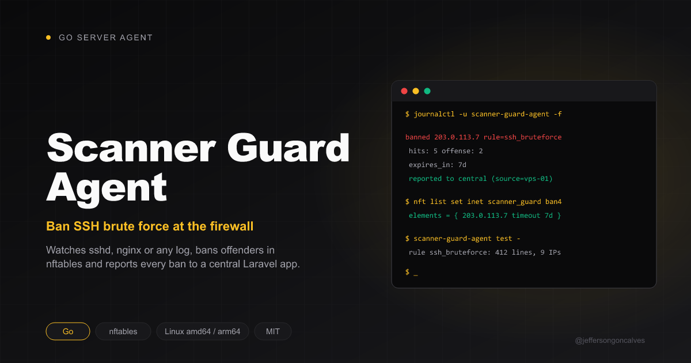

# Scanner Guard Agent

[](https://github.com/jeffersongoncalves/scanner-guard-agent/actions/workflows/tests.yml)
[](https://github.com/jeffersongoncalves/scanner-guard-agent/releases)
[](LICENSE.md)

A small static Go binary for Linux servers. It watches logs (sshd, nginx, postfix, anything that
logs an IP), bans abusive IPs in nftables and reports every ban to a central
[`laravel-scanner-guard`](https://github.com/jeffersongoncalves/laravel-scanner-guard) app. It also
pulls the central denylist back, so an IP banned by any app or server is dropped on every server.

```
sshd / nginx / postfix logs ──► agent ──► nftables (local drop)
                                  │
                                  ├─ POST ban (HMAC) ──► central laravel-scanner-guard app
                                  └─ GET denylist (HMAC) ◄─┘   (bans from every app and server)
```

- No runtime dependencies: one binary (`CGO_ENABLED=0`), linux amd64 and arm64.
- Reads journald (through `journalctl`) or plain files, and follows logrotate and copytruncate.
- Generic rules: regex patterns with an `<ip>` placeholder, threshold, window and an escalation ladder.
- Uses its own nftables table (`inet scanner_guard`) and never touches your other rules. It coexists with fail2ban.
- Drops in `prerouting`, before Docker's DNAT, so a ban also covers published container ports.
- Optional nginx and Apache denylist files, for servers behind a proxy or CDN.
- `test` command replays a log through the rules before anything gets banned.

## Install

Script (checks the release checksum):

```bash
curl -fsSL https://raw.githubusercontent.com/jeffersongoncalves/scanner-guard-agent/main/install.sh | sudo sh
# pin a version: curl ... | sudo VERSION=1.0.0 sh
```

Or a package from the [releases](https://github.com/jeffersongoncalves/scanner-guard-agent/releases):

```bash
sudo dpkg -i scanner-guard-agent_1.0.0_linux_amd64.deb   # Debian / Ubuntu
sudo rpm -i  scanner-guard-agent_1.0.0_linux_amd64.rpm   # RHEL / Alma / Rocky
```

Requires `nftables` (`apt install nftables` / `dnf install nftables`) and systemd.

## Configure

Edit `/etc/scanner-guard/agent.yaml`, the [example config](packaging/agent.yaml) ships with an sshd rule:

```yaml
source: vps-01                 # name in the central ban table (default: hostname)
central:
  url: https://central.example.com/scanner-guard/bans
  secret_file: /etc/scanner-guard/secret
  pull_interval: 60s
firewall: nftables             # or "none" for a dry run
ignore: [203.0.113.10, 10.0.0.0/8]   # YOUR OWN IPs. 127.0.0.0/8 and ::1 are always ignored
rules:
  - name: ssh_bruteforce       # becomes the ban "reason" on the central app (max 30 chars)
    journald: [ssh.service, sshd.service]   # or: file: /var/log/auth.log
    patterns:
      - 'Failed (password|publickey) for (invalid user )?\S+ from <ip> port'
      - 'Invalid user \S* from <ip> port'
    threshold: 5
    window: 10m
    ban: [1d, 7d, 30d]         # 1st, 2nd, 3rd+ offense
```

> **Warning:** put the IPs you administer the server from in `ignore` before you start the agent.
> Otherwise a few mistyped passwords lock you out. Start with `firewall: none` to watch what it
> would ban.

Test a rule against real logs first:

```bash
journalctl -u ssh -u sshd --since -1d -o cat | scanner-guard-agent test -
scanner-guard-agent test -rule nginx_scanner /var/log/nginx/access.log
```

Add `-ban` to also ban what the replay found: each IP over the threshold gets the next escalation
step, is blocked in nftables and reported to the central app. Use it once on install to catch the
attacks already in the logs. Stop the agent first, both write the same state file:

```bash
sudo systemctl stop scanner-guard-agent
sudo journalctl -u ssh -u sshd --since -7d -o cat | sudo scanner-guard-agent test -ban -
sudo systemctl start scanner-guard-agent
```

The window is ignored here, so hits spread over the whole period count together. Narrow
`--since` if that bans too much.

Then start it:

```bash
sudo systemctl enable --now scanner-guard-agent
journalctl -u scanner-guard-agent -f
```

## Central app

The agent speaks the `http` driver protocol of `laravel-scanner-guard`. On the central app
(`database` driver):

```dotenv
SCANNER_GUARD_HTTP_SERVER_ENABLED=true
SCANNER_GUARD_HTTP_SECRET=a-long-random-shared-secret
```

On the server, store the same secret (or a per-source one from `http.secrets`):

```bash
echo 'a-long-random-shared-secret' | sudo tee /etc/scanner-guard/secret >/dev/null
sudo chmod 600 /etc/scanner-guard/secret
```

Each ban is POSTed with `reason` = rule name, `source` = `source`, `matched_value` = the pattern
that matched (never the log line, which holds the raw IP), `hit_count`, `offense`, `banned_at` and
`expires_at`, signed as `X-Signature: hmac_sha256(X-Timestamp . body, secret)`. It then shows up in
the central ban table, the daily stats and the central denylist sinks (Cloudflare, nginx, ...):

```php
ScannerGuardBan::query()->where('source', 'vps-01')->where('reason', 'ssh_bruteforce')->get();
```

Every `pull_interval` the agent GETs the central denylist (active bans plus `ip_blocklist`) and
syncs it into nftables. It adds new entries and lifts the ones the central app no longer lists,
except bans this agent made itself. Use an `https` URL: the pulled list holds raw IPs and isn't
signed.

After each pull the agent also POSTs a signed heartbeat to `<central.url>/heartbeat` (`source`,
`version`, `rules`, `active_bans`, `started_at`). On the central app, run the
`create_scanner_guard_agents_table` migration, then spot dead servers with
`ScannerGuardAgent::query()->offline()->get()`. Central versions without the endpoint answer
`404`. The agent logs that and keeps working.

Without `central.url` the agent runs standalone and only bans locally.

## Behind a proxy or CDN: nginx and Apache denylists

Behind Cloudflare or a load balancer, nftables only sees the proxy's IP, so it can't block the
visitor. The agent can also write this server's active bans (its own plus the pulled ones) to a web
server config file:

```yaml
ignore: [203.0.113.10, 173.245.48.0/20]   # your own IPs AND every proxy/CDN range
denylists:
  - format: nginx                         # nginx | apache
    path: /var/lib/scanner-guard/nginx-deny.conf
```

> **Warning:** restore the client IP first (below) and put the proxy ranges in `ignore`. Otherwise the
> access log holds the proxy's IP, and a rule on it bans the proxy itself. Trust only the proxy's
> ranges, or anyone can forge the header.

nginx, e.g. `/etc/nginx/conf.d/scanner-guard.conf` (covers every site):

```nginx
set_real_ip_from 173.245.48.0/20;   # repeat for every proxy range
real_ip_header CF-Connecting-IP;
include /var/lib/scanner-guard/nginx-deny*.conf;
```

A `server` or `location` with its own `allow`/`deny` doesn't inherit the list, repeat the `include`
there.

Apache 2.4 (`mod_remoteip`), at the end of each virtual host, with `format: apache` and the path
`/var/lib/scanner-guard/apache2-deny.conf` (`httpd-deny.conf` on RHEL / Alma / Rocky):

```apache
RemoteIPHeader CF-Connecting-IP
RemoteIPTrustedProxy 173.245.48.0/20

<Location "/">
    AuthMerging And
    IncludeOptional /var/lib/scanner-guard/apache2-deny*.conf
</Location>
```

Keep `AuthMerging And`: without it, the list's `Require all granted` replaces your own rules. Also log
the restored IP: `%a` instead of `%h` in `LogFormat`.

Then reload the web server whenever the list changes. The unit's instance is the service name, and it
watches `/var/lib/scanner-guard/<service>-deny.conf`:

```bash
sudo systemctl restart scanner-guard-agent
sudo systemctl enable --now scanner-guard-reload@nginx.path     # or @apache2.path, @httpd.path
sudo systemctl reload nginx
```

- The file is checked every 10s and only rewritten when its content changes. Expired bans are removed.
- After a restart the previous list stays until the first pull succeeds (5 minutes at most).
- While the agent is stopped the list is frozen, expired bans included.
- `firewall: none` is a dry run and doesn't write the files. To stop using one, delete it and reload.
- The systemd sandbox only allows `/var/lib/scanner-guard`. Any other path needs a `ReadWritePaths=`
  drop-in, and your own reload unit.

## Manage bans

```bash
nft list table inet scanner_guard                                   # everything blocked
nft delete element inet scanner_guard ban4 '{ 203.0.113.7 }'        # unban now (ban6 for IPv6)
```

A ban that also came from the central app is re-added on the next pull. Unban it there instead
(`ScannerGuard::unban()`).

`nft delete` doesn't touch the nginx/Apache denylists. To lift a local ban from those too, add the IP
to `ignore` and restart the agent.

## State and restarts

The agent keeps its escalation steps and the local bans still running in `state_file` (default
`/var/lib/scanner-guard/state.json`, created by the systemd unit's `StateDirectory`). On start it
recreates its nftables table, re-applies those bans for their remaining time, and the first pull
brings back the central ones. An escalation step is forgotten once the IP has had no ban for
`escalation_lookback` (default `365d`), and the ladder starts over:

```yaml
state_file: /var/lib/scanner-guard/state.json
escalation_lookback: 365d
```

A corrupt state file is logged and replaced by an empty one, so it never keeps the agent down.

## Notes and limits

- Line timestamps are not parsed: the window is measured on arrival time.
- Hit counters (below the threshold) live in memory and start from zero after a restart.

## Build

```bash
GOOS=linux GOARCH=amd64 CGO_ENABLED=0 go build -o dist/scanner-guard-agent .
go test ./...
```

Releases are built by GoReleaser on a tag push (`.goreleaser.yaml`): tar.gz, `.deb`, `.rpm` and
`checksums.txt` for linux amd64/arm64.

## License

The MIT License (MIT). Please see [License File](LICENSE.md) for more information.
